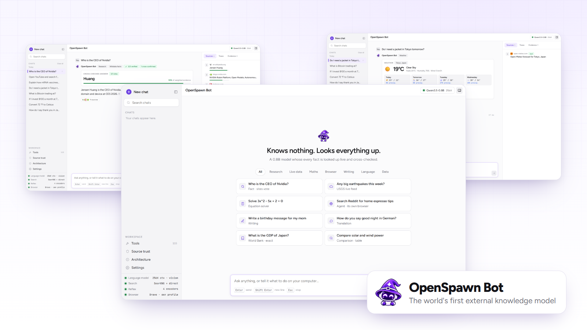
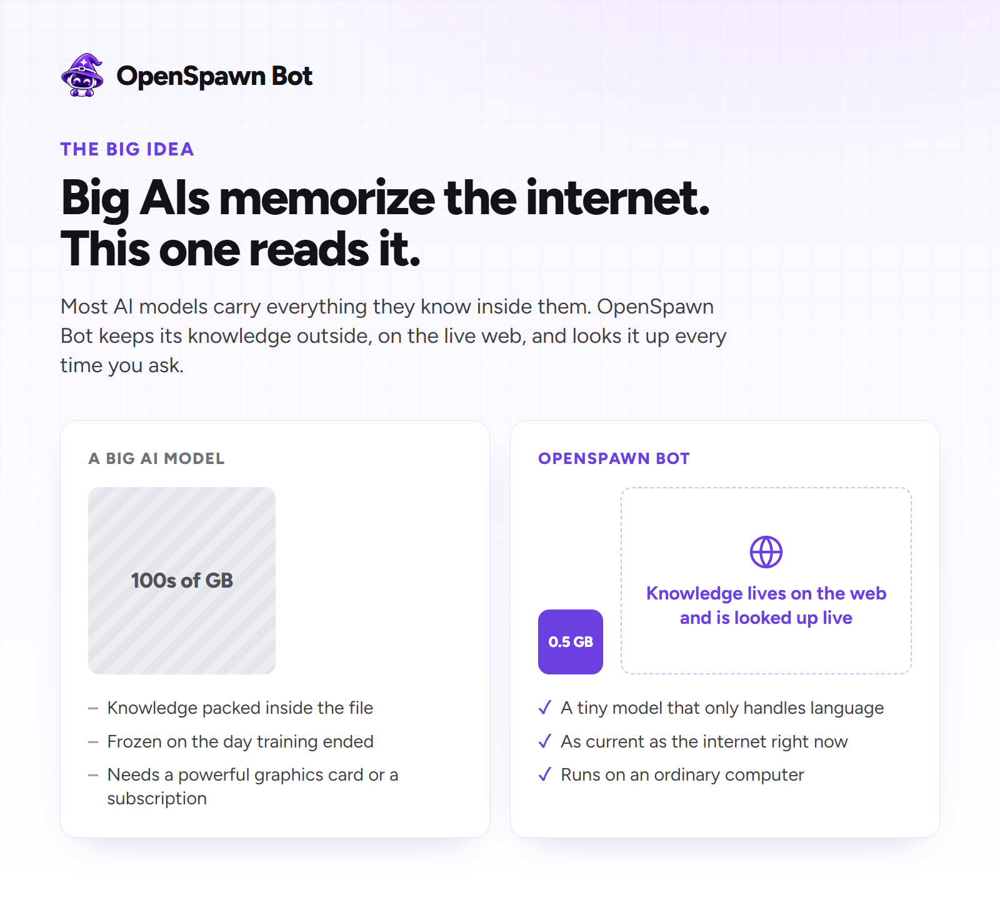
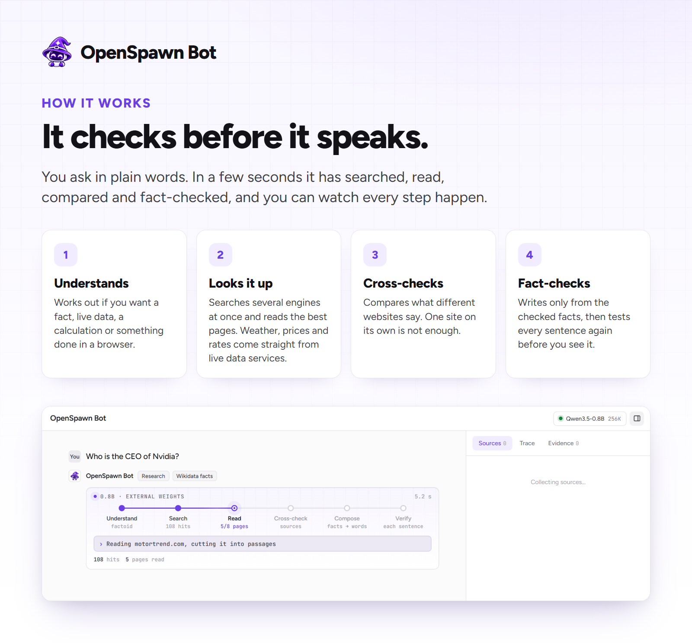
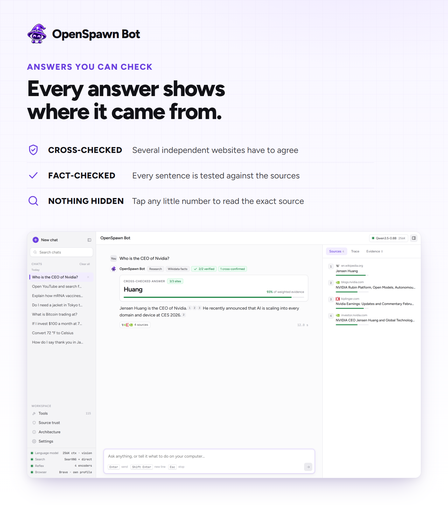
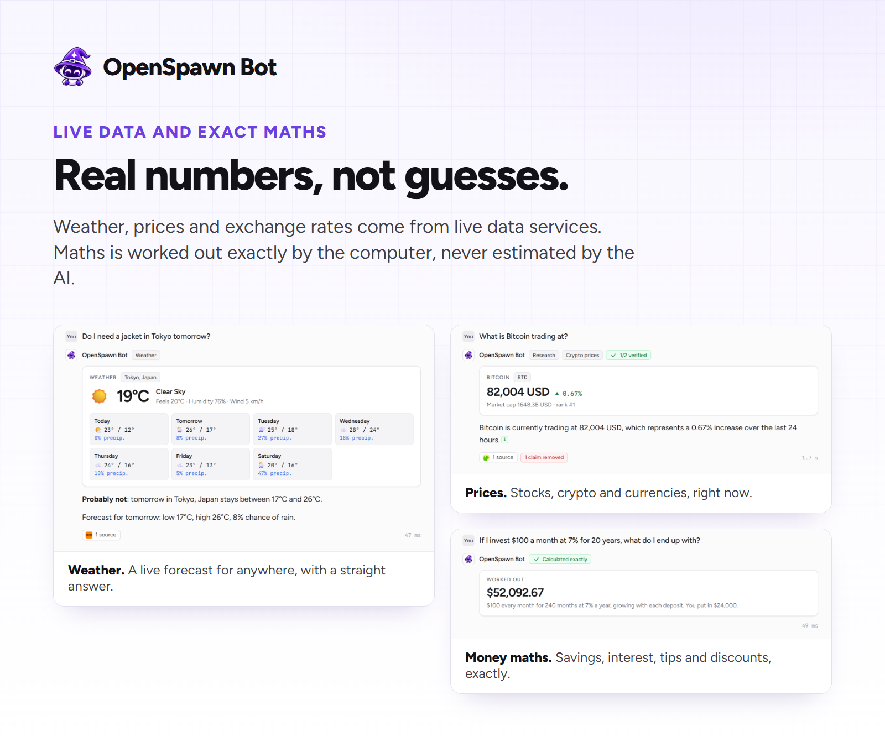
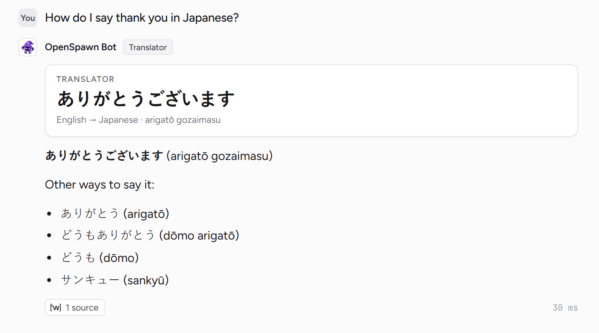
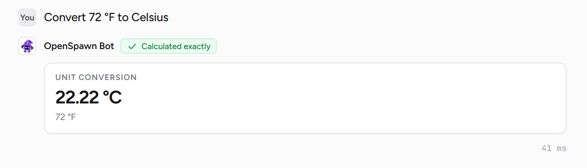
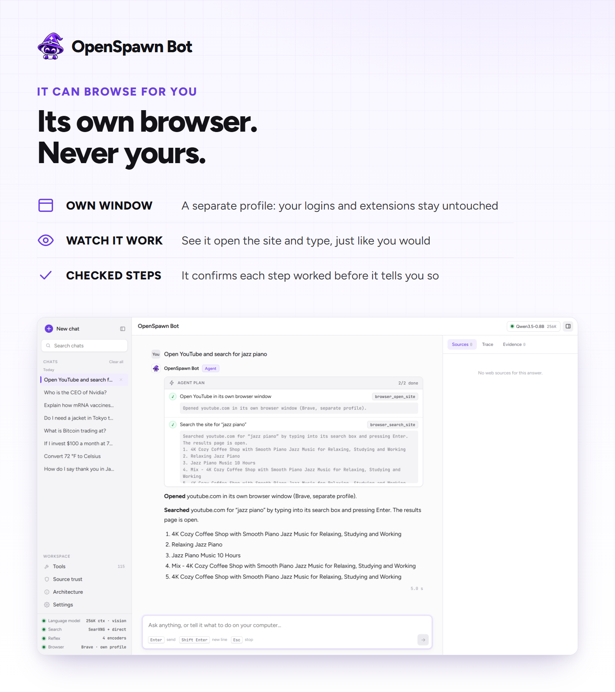
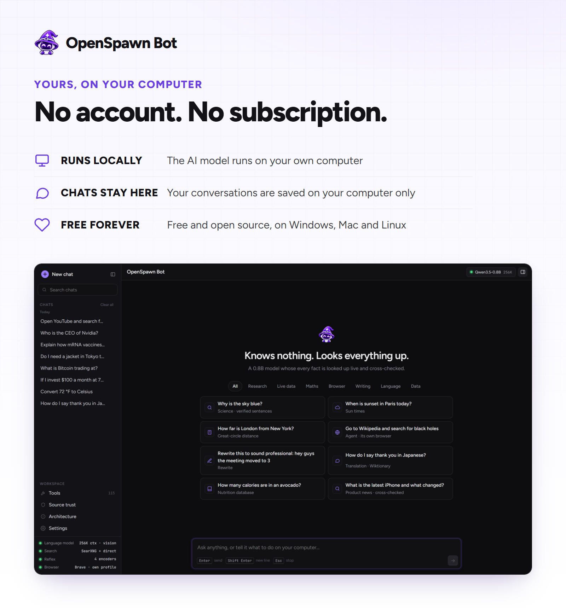

  

<h1 align="center">OpenSpawn Bot</h1>

  <b>The world's first external knowledge model.</b> 
  A tiny AI that knows nothing by heart, so it looks everything up. 
  It searches the web, checks what it finds across several websites, and only then answers you.

  &nbsp;&nbsp;
  &nbsp;&nbsp;
  &nbsp;&nbsp;
  &nbsp;&nbsp;
  &nbsp;&nbsp;
  

  <picture><source media="(prefers-color-scheme: dark)" srcset="images/brand/windows-light.png"></picture>&nbsp; <b>Windows</b> 10 · 11 &nbsp;&nbsp;&nbsp;&nbsp;
  <picture><source media="(prefers-color-scheme: dark)" srcset="images/brand/mac-light.png"></picture>&nbsp; <b>macOS</b> · Intel and Apple Silicon &nbsp;&nbsp;&nbsp;&nbsp;
  <picture><source media="(prefers-color-scheme: dark)" srcset="images/brand/linux-light.png"></picture>&nbsp; <b>Linux</b> · Ubuntu, Debian, Arch, Fedora, Omarchy and more

## Download

| Platform&nbsp;&nbsp;&nbsp;&nbsp;&nbsp;&nbsp;&nbsp;&nbsp;&nbsp;&nbsp;&nbsp;&nbsp;&nbsp;&nbsp;&nbsp;&nbsp;&nbsp;&nbsp;&nbsp;&nbsp;&nbsp;&nbsp;&nbsp;&nbsp;&nbsp;&nbsp;&nbsp;&nbsp;&nbsp;&nbsp;&nbsp;&nbsp;&nbsp;&nbsp; | Build&nbsp;&nbsp;&nbsp;&nbsp;&nbsp;&nbsp; | Download&nbsp;&nbsp;&nbsp;&nbsp;&nbsp;&nbsp;&nbsp;&nbsp;&nbsp;&nbsp;&nbsp;&nbsp;&nbsp;&nbsp;&nbsp;&nbsp;&nbsp;&nbsp;&nbsp;&nbsp;&nbsp;&nbsp;&nbsp;&nbsp;&nbsp;&nbsp;&nbsp;&nbsp;&nbsp;&nbsp;&nbsp;&nbsp;&nbsp;&nbsp;&nbsp;&nbsp;&nbsp;&nbsp;&nbsp;&nbsp;&nbsp;&nbsp;&nbsp;&nbsp;&nbsp;&nbsp;&nbsp;&nbsp;&nbsp;&nbsp;&nbsp;&nbsp;&nbsp;&nbsp; |
| :-- | :-- | :-- |
| <picture><source media="(prefers-color-scheme: dark)" srcset="images/brand/windows-light.png"></picture>&nbsp;&nbsp;**Windows** (10 and 11) | 64-bit · Intel and AMD | [OpenSpawn-Bot-Installer.exe](https://github.com/TheSpawner/OpenSpawnBot/releases/latest/download/OpenSpawn-Bot-Installer.exe) |
| <picture><source media="(prefers-color-scheme: dark)" srcset="images/brand/mac-light.png"></picture>&nbsp;&nbsp;**macOS** (Intel and Silicon) | Apple Silicon · M1 and later | [OpenSpawn-Bot-Installer-AppleSilicon.pkg](https://github.com/TheSpawner/OpenSpawnBot/releases/latest/download/OpenSpawn-Bot-Installer-AppleSilicon.pkg) |
| | Intel · 64-bit Macs | [OpenSpawn-Bot-Installer-Intel.pkg](https://github.com/TheSpawner/OpenSpawnBot/releases/latest/download/OpenSpawn-Bot-Installer-Intel.pkg) |
| <picture><source media="(prefers-color-scheme: dark)" srcset="images/brand/linux-light.png"></picture>&nbsp;&nbsp;**Linux** (almost all distros) | Ubuntu, Debian, Mint and relatives | [OpenSpawn-Bot-Installer.deb](https://github.com/TheSpawner/OpenSpawnBot/releases/latest/download/OpenSpawn-Bot-Installer.deb) |
| | Arch, Fedora, Omarchy and the rest | [OpenSpawn-Bot-Installer.sh](https://github.com/TheSpawner/OpenSpawnBot/releases/latest/download/OpenSpawn-Bot-Installer.sh) |

**Small download, everything else fetched for you:** the installer only carries the app. The first time OpenSpawn Bot opens, it downloads what it runs on, once: the Qwen3.5 0.8B language model from Hugging Face, the llama.cpp engine, four small fact-checking models and its own private search engine (SearXNG). That is about 1 GB, and a progress bar shows how far along it is. Uninstalling removes all of it again.

### Install And Uninstall

<picture><source media="(prefers-color-scheme: dark)" srcset="images/brand/windows-light.png"></picture>&nbsp;&nbsp;**Windows** (10 and 11)

| Install&nbsp;&nbsp;&nbsp;&nbsp;&nbsp;&nbsp;&nbsp;&nbsp;&nbsp;&nbsp; | Uninstall&nbsp;&nbsp;&nbsp;&nbsp;&nbsp;&nbsp;&nbsp;&nbsp;&nbsp;&nbsp;&nbsp;&nbsp;&nbsp;&nbsp;&nbsp;&nbsp;&nbsp;&nbsp;&nbsp;&nbsp;&nbsp;&nbsp;&nbsp;&nbsp;&nbsp;&nbsp;&nbsp;&nbsp;&nbsp;&nbsp;&nbsp;&nbsp;&nbsp;&nbsp;&nbsp;&nbsp;&nbsp;&nbsp;&nbsp;&nbsp; |
| :-- | :-- |
| Open `OpenSpawn-Bot-Installer.exe` → More info → Run anyway → Install → Done | Start menu → Uninstall OpenSpawn Bot or Settings → Apps → OpenSpawn Bot → Uninstall |

<picture><source media="(prefers-color-scheme: dark)" srcset="images/brand/mac-light.png"></picture>&nbsp;&nbsp;**macOS** (14 Sonoma and later)

| Family&nbsp;&nbsp;&nbsp;&nbsp;&nbsp;&nbsp;&nbsp;&nbsp;&nbsp;&nbsp;&nbsp;&nbsp; | Install&nbsp;&nbsp;&nbsp;&nbsp;&nbsp;&nbsp; | Uninstall&nbsp;&nbsp;&nbsp;&nbsp;&nbsp;&nbsp;&nbsp;&nbsp;&nbsp;&nbsp;&nbsp;&nbsp;&nbsp;&nbsp;&nbsp;&nbsp;&nbsp;&nbsp;&nbsp;&nbsp;&nbsp;&nbsp;&nbsp;&nbsp;&nbsp;&nbsp;&nbsp;&nbsp;&nbsp;&nbsp;&nbsp;&nbsp;&nbsp;&nbsp;&nbsp;&nbsp;&nbsp;&nbsp;&nbsp;&nbsp;&nbsp;&nbsp;&nbsp;&nbsp; |
| :-- | :-- | :-- |
| Apple Silicon M1 and later | Open `OpenSpawn-Bot-Installer-AppleSilicon.pkg`. Blocked the first time: System Settings → Privacy & Security → Open Anyway, then open it again → Continue → Install | Open Terminal and: `sudo openspawn-bot-uninstall` |
| Intel 64-bit Macs | Open `OpenSpawn-Bot-Installer-Intel.pkg`. Same steps: Open Anyway once, then Continue → Install | Open Terminal and: `sudo openspawn-bot-uninstall` |

<picture><source media="(prefers-color-scheme: dark)" srcset="images/brand/linux-light.png"></picture>&nbsp;&nbsp;**Linux** (every major distribution)

| Family&nbsp;&nbsp;&nbsp;&nbsp;&nbsp;&nbsp;&nbsp;&nbsp;&nbsp;&nbsp;&nbsp;&nbsp; | Install&nbsp;&nbsp;&nbsp;&nbsp;&nbsp;&nbsp; | Uninstall&nbsp;&nbsp;&nbsp;&nbsp;&nbsp;&nbsp;&nbsp;&nbsp;&nbsp;&nbsp;&nbsp;&nbsp;&nbsp;&nbsp;&nbsp;&nbsp;&nbsp;&nbsp;&nbsp;&nbsp;&nbsp;&nbsp;&nbsp;&nbsp;&nbsp;&nbsp;&nbsp;&nbsp;&nbsp;&nbsp;&nbsp;&nbsp;&nbsp;&nbsp;&nbsp;&nbsp;&nbsp;&nbsp;&nbsp;&nbsp;&nbsp;&nbsp;&nbsp;&nbsp; |
| :-- | :-- | :-- |
| `.deb` Ubuntu, Debian, Mint | Open `OpenSpawn-Bot-Installer.deb` → Install | `sudo openspawn-bot-uninstall` |
| `.sh` Arch, Fedora, Omarchy etc. | `chmod +x OpenSpawn-Bot-Installer.sh` `sudo ./OpenSpawn-Bot-Installer.sh` | `sudo openspawn-bot-uninstall` |

Uninstalling removes the app, its language model, its engine and its search engine. Your chats and settings stay on your computer unless you choose to delete them too: Windows asks you, and on macOS and Linux add `--purge` to the uninstall command.

## What Is OpenSpawn Bot?

  

AI chatbots usually work like someone who crammed the whole internet the night before an exam. Everything they know is squeezed inside the model itself: enormous files that need powerful, expensive hardware, holding knowledge that stops on the day their training ended.

OpenSpawn Bot turns that around. Its brain is a tiny language model of about half a gigabyte, and it is only trusted with one job: language. Every fact comes from outside, from the live web and from official data services, and it is checked against other sources before a single word reaches you.

The knowledge lives on the internet, not inside the file. That is what we mean by an **external knowledge model**.

| | A big AI model on its own | OpenSpawn Bot |
| :-- | :-- | :-- |
| **Where its knowledge lives** | Inside the model | On the live internet |
| **Size** | Tens to hundreds of gigabytes | About half a gigabyte |
| **What you need to run it** | A powerful graphics card, or a paid subscription | An ordinary computer |
| **How up to date it is** | Frozen when its training ended | As current as the web right now |
| **Checks its own facts** | Usually not | Every sentence, against several websites |
| **Shows where answers come from** | Sometimes | Every time |

## How It Works

  

You ask in plain words, the same way you would ask a friend. Then, in a few seconds:

| | Step | What happens |
| :-: | :-- | :-- |
|  | **It understands you** | It works out whether you want a fact, live numbers, a calculation, a translation or something done on a website. There are no modes to pick and no settings to learn. |
|  | **It looks it up** | It searches several search engines at once and reads the most useful pages. Weather, prices and exchange rates come straight from live data services. |
|  | **It cross-checks** | It compares what different websites say and lets them vote. One website on its own is never enough. |
|  | **It fact-checks** | The tiny model writes the answer only from the checked facts. Then every sentence is tested against the sources again, and anything that does not hold up is removed before you read it. |

Numbers never go through the AI at all. Maths, unit conversions and money questions are worked out exactly by your computer.

## Answers You Can Check

  

Every answer comes with its sources. Tap any little number to read the exact sentence it came from. When websites agree, you can see how many of them did. When they disagree, OpenSpawn Bot tells you, rather than quietly picking one. And when the fact-checker throws a sentence out, you can see what was removed and why.

## Live Data And Exact Maths

  

| | Ask about | Try |
| :-: | :-- | :-- |
|  | **Weather** | *“Do I need a jacket in Tokyo tomorrow?”* |
|  | **Prices** | *“What is Bitcoin trading at?”* · *“How is Apple stock doing today?”* · *“Convert 250 euros to Japanese yen”* |
|  | **Money maths** | *“If I invest $100 a month at 7% for 20 years, what do I end up with?”* · *“What is an 18% tip on $64.50?”* |
|  | **Conversions** | *“Convert 72 °F to Celsius”* · *“How many hours are in 3 weeks?”* |
|  | **Words** | *“How do I say thank you in Japanese?”* · *“What does ephemeral mean?”* |
|  | **Facts and news** | *“Who is the CEO of Nvidia?”* · *“Who won the 2026 FIFA World Cup?”* |
|  | **Explanations** | *“Explain how mRNA vaccines work”* · *“Why is the sky blue?”* |

<table>
  <tr>
    <td width="50%"></td>
    <td width="50%"></td>
  </tr>
</table>

## It Can Browse For You

  

Ask it to open a website and search for something, or to put some music on. OpenSpawn Bot opens **its own browser window** with a separate profile, so your passwords, logins and extensions are never touched. You can watch it type, just like you would.

Every step is checked before it tells you anything. It only says it searched once a results page for your search is really open, and it only says something is playing once it really is. If a website asks it to prove it is human, it stops and leaves that to you.

 Works with Chrome, Edge, Brave, Vivaldi and other Chromium-based browsers. It uses your default one if it can.

## Yours, On Your Computer

  

| | |
| :-: | :-- |
|  | **The AI runs on your computer.** No cloud AI account, no subscription, nothing to sign up for. |
|  | **Your chats stay on your computer.** They are saved on your own disk, and you can delete them whenever you like. |
|  | **Nothing hidden.** To answer, it sends searches to search engines and opens websites, exactly like you would in a browser, and it shows you every page it read. |
|  | **Free and open source.** On Windows, macOS and Linux. Light and dark mode included. |

## What You Need

| | |
| :-- | :-- |
| **Computer** | Windows 10 or 11, macOS 14 or later on Intel or Apple Silicon, or Linux (almost every distribution) |
| **Memory** | 8 GB or more recommended |
| **Disk space** | About 2 GB: the app, plus what it downloads on first start (its half-gigabyte language model, the llama.cpp engine, four small checking models and its search engine) |
| **Internet** | Yes. That is where its knowledge lives. |
| **Graphics card** | Optional. Answers are quicker with one, and it runs on the processor without one. |
| **Browser** | Optional, for browsing tasks: any Chromium-based browser such as Chrome, Edge or Brave |

## Questions

**Is it really free?** 
Yes. No account, no subscription and no ads. The whole thing is open source.

**Does it work without the internet?** 
Maths and conversions do, and you can still chat with it. Questions about the world need the internet, because that is where the answers live.

**How fast is it?** 
Most questions take somewhere between 5 and 15 seconds, because it is really searching and reading websites for you. Maths, conversions and the weather usually come back in under a second.

**Is it as smart as ChatGPT?** 
It is not trying to know more than the big AIs. It is trying to be right about what it tells you, and to show its work. For facts, live numbers and maths, that works remarkably well for something half a gigabyte in size. For long creative writing or difficult reasoning, bigger models are still better.

**Which AI is inside?** 
The language model is Qwen3.5 0.8B from the Qwen team, running on your computer through llama.cpp. Four small specialist models do the searching, ranking, reading and fact-checking around it.

**Can I see how it reached an answer?** 
Yes. Every answer has a Sources tab, an Evidence tab with the passages it relied on, and a Trace tab that shows how long each step took.

## Open Source

OpenSpawn Bot is built in the open. If it gets something wrong, open an issue with the exact question you asked. That is the most useful bug report there is.

   
  <b>Knows nothing. Looks everything up.</b>

